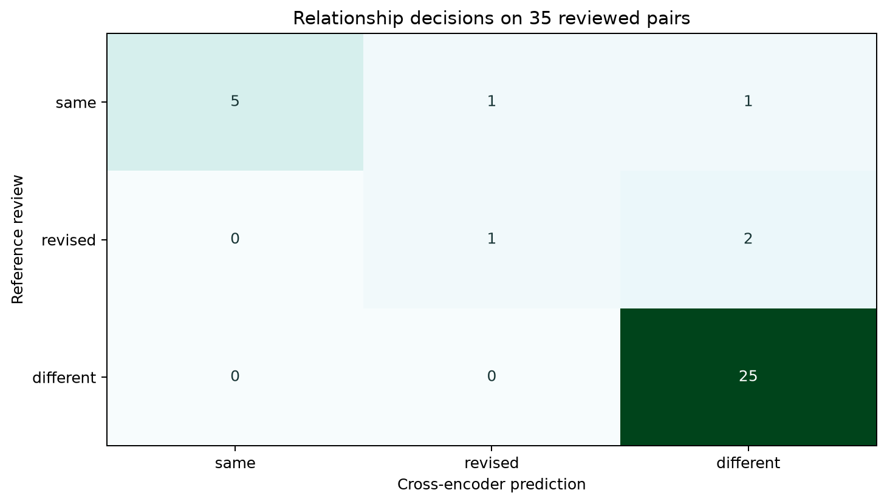
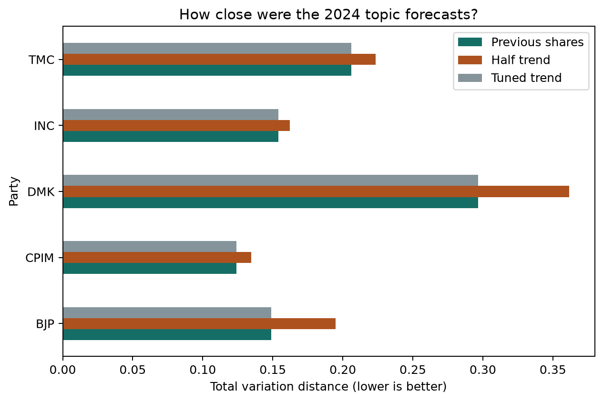

# Tracking and Forecasting Pledges in Indian Election Manifestos

## Changes in this version

The current MiniLM trainer in `src/07_train_cross_encoder.py` runs for five fixed epochs. Its progress message uses the configured epoch count. The Windows launcher sets up Python 3.14 with CUDA-enabled PyTorch and reads the master passage CSV copied from the sentiment project. [Training code](src/07_train_cross_encoder.py) · [Launcher](run_all.py)

## Data

The corpus contains 21 English Lok Sabha manifestos from BJP, Congress, CPI(M), AIADMK, DMK and TMC. It covers elections from 2009 to 2024. Splitting 9,572 passages produces 15,376 candidate quasi-sentences. Each keeps a document ID, PDF page and offsets within its parent passage. DMK and TMC enter in 2014. AIADMK has three included elections and its 2024 English edition is pending. [Corpus](reference/data/) · [Source inventory](data/sources.csv)

The passage table contains **848 OCR passages from five documents**. Four documents account for 840 of those passages. AIADMK 2014 contributes the remaining eight. Extraction counts document how much text depended on OCR. Word error rates require source transcriptions. The audit script exports a spot-check form with document links and page numbers. [OCR counts](reference/followup/ocr_passages_by_document.csv)

## Methods

1. **Detect pledges.** Rules identify future commitments and clear descriptions of the past, and abstain in uncertain cases. Train a logistic regression classifier using TF-IDF and frozen MiniLM embeddings on historical weak labels through 2019.
2. **Assign topics and forecast.** Use ManifestoBERTa’s 56 policy categories. Compare repeating the previous election’s topic shares with extending the recent trend. Evaluate on 2024 topic shares estimated from detected pledges. Use the latest available shares to generate exploratory 2029 forecasts for the five parties with 2024 coverage.
3. **Find and compare pledges.** Search the same party’s previous manifesto with BM25 and MiniLM, then combine their ranks. Fine-tune a MiniLM cross-encoder in PyTorch on rule-labeled historical pairs and controlled edits. The model classifies the retrieved pairs as same, revised, different or unclear. Rules highlight quantities or edited phrases when a pair is classified as a revision.
4. **Evaluate separately.** A targeted challenge measures whether earlier matches appear in the top five. A fixed set of language-model-reviewed pairs measures relation agreement and whether the highlighted text supports the claimed change.

The full model names and pinned revisions are recorded in the checkpoint manifest. The relation model uses 0.65 as a working abstention cutoff. The threshold grid below describes how the saved predictions behave from 0.50 to 0.90. [Checkpoints and file hashes](data/models.json)

## Analysis and results

These tables describe the completed local GPU run with **five fixed training epochs**. The sentiment and pledge projects contain byte-identical copies of the master passage CSV. The pledge pipeline sent 7,625 later statements to search across 15 adjacent party-election transitions and scored 38,125 top-five pairs. [Selected matches](outputs/comparison/best_matches.csv)

### Pledge detection

The detector trained on 1,906 rule-labelled statements from elections through 2019. In 2024 the rules labelled 962 of 4,020 statements, and the detector agreed with 97.7% of those labels. The rules abstained on the other 3,058 statements. The percentage measures agreement on the subset with weak labels. Independent pledge judgements would be needed to estimate detector accuracy. [Rule agreement](outputs/pledges/agreement_with_2024_rules.json) · [Rule coverage](outputs/pledges/weak_coverage.csv)

### Retrieval

The exploratory challenge contains 11 later statements, seven with an earlier reference match. The pledge filter admitted five of those seven. The following table counts a hit when the method ranks at least one earlier reference in its top five. The end-to-end system selected a correct earlier statement for two of the seven queries. [Retrieval results](outputs/figures/03_retrieval.csv) · [End-to-end outcomes](outputs/comparison/retrieval_challenge.csv)

| Method | With pledge filter | Without pledge filter |
|---|---:|---:|
| BM25 | 3/7 | 5/7 |
| Dense MiniLM | 4/7 | 6/7 |
| Hybrid rank fusion | 4/7 | 6/7 |

### Pledge comparison and evidence

The cross-encoder trained on 2,063 pairs from historical text. There were 863 labelled same, 700 different, and 500 revised. All 500 revision examples were produced by editing quantities. The test file yielded 38 unique 2019–2024 pairs after deduplication. Three unclear reference labels were excluded, leaving 35 scored pairs. The reference labels were generated by a language model. [Training examples](outputs/comparison/training_pairs.csv) · [Test decisions](outputs/comparison/test_decisions.csv)

| Method | Agreement with reference | Abstentions | Macro-F1 | Revision F1 |
|---|---:|---:|---:|---:|
| Always different | 25/35 | 0 | 0.278 | 0.000 |
| Rule baseline | 21/35 | 13 | 0.473 | 0.000 |
| Five-epoch MiniLM cross-encoder | 31/35 | 0 | 0.726 | 0.400 |

The cross-encoder found **one of three reference revisions** and flagged two pairs as revised, giving revision precision of 50% and recall of 33.3% on this panel. It correctly flagged the change from passing a bill to amending an enacted law in the CPI(M) manifestos. Its highlights were the two years, leaving the changes in the legislative action and instrument outside the highlighted spans. On the 2014–2019 pilot panel it agreed on 30 of 37 determinate pairs, abstained on three, and missed all four reviewed revisions at the 0.65 cutoff. That earlier panel can overlap historical training text. [Metrics](outputs/comparison/test_metrics.csv) · [Evaluation and pilot counts](outputs/comparison/evaluation.json)

A retrospective check of the saved test probabilities gave 31 correct decisions, one correctly flagged revision, and zero abstentions at every tested cutoff from 0.50 through 0.70. At 0.80 and 0.90 one additional pair was withheld, yielding 30 correct decisions and zero correctly flagged revisions. The 0.65 cutoff is the existing working setting. [Saved scores](outputs/comparison/panel_predictions.csv)

The end-to-end system flagged 40 pairs as revised in 2024. Nineteen matched entries in the archived review and 21 await review. The archive marked seven of those 19 as revisions. In three of the seven, the unchanged highlighted spans supported a material change. This audit describes the overlap with the earlier review. [Revision audit](outputs/figures/05_revision_audit.csv)

### Topic forecasts

Carrying forward the previous election's topic shares gave lower 2024 total variation distance than the fixed half-trend for all five evaluated parties. The mean distances were 0.186 for carrying forward the shares and 0.215 for the half-trend. The historical tuning selected a trend weight of zero, so the tuned forecast equals the carry-forward forecast. These scores measure error against topic shares estimated from detected pledges. The pipeline also exports exploratory 2029 estimates. [Forecast summary](outputs/pledges/forecast_summary.csv) · [Historical tuning](outputs/pledges/historical_tuning.csv)

### Follow-up comparisons

The repository includes scripts for frozen DeBERTa and Qwen relation baselines, a frozen MiniLM reranker, 16 constructed relation controls, and training variants that compare legacy edits with date-safe edits and weakly labelled historical candidates. The new model comparisons require a separate run. The control labels are known by construction and the historical candidates retain their source text and page provenance. [Experiment commands and output definitions](EXPERIMENTS.md)

## Conclusion

In the saved challenge, filtering later statements reduced how often search recovered an earlier match. The five-epoch model found one of the three reviewed revisions, with a highlight that captured dates but missed the changed obligation. This separates relation recognition from the ability to point to supporting evidence. The 2024 backtest favours carrying the previous election’s topic shares forward among the tested approaches. The 2029 values remain exploratory forecasts of model-assigned topic shares.

## Future work

A subsequent study should build an independently human-annotated benchmark of natural revisions and retrieval queries. Two readers would code the same held-out pairs using the source PDFs and the codebook, record the words that change the obligation, and resolve disagreements after recording their initial judgments. The study would report inter-annotator agreement and class counts, document any oversampling of likely revisions, and audit OCR and pledge detection against the corresponding source pages. These data would support a stronger estimate of how well the system finds and explains material changes across parties.

## References

- Fornaciari, T., Hovy, D., Naurin, E., Runeson, J., Thomson, R., and Adhikari, P. (2021). “We will Reduce Taxes” — Identifying Election Pledges with Language Models. *Findings of ACL-IJCNLP*, 3406–3419. This study supplies the closest precedent for pledge detection in Indian and Swedish manifestos. [ACL Anthology](https://aclanthology.org/2021.findings-acl.301/)
- Thomson, R., Royed, T., Naurin, E., et al. (2017). The Fulfillment of Parties’ Election Pledges: A Comparative Study on the Impact of Power Sharing. *American Journal of Political Science*, 61(3), 527–542. This study supplies the comparative political-science background for defining election commitments. [Journal article](https://onlinelibrary.wiley.com/doi/10.1111/ajps.12313)
- Manifesto Project. *Manifesto Coding Instructions*, fourth edition. The codebook supplies the quasi-sentence concept and standard policy categories used by ManifestoBERTa. [Coding handbook](https://manifestoproject.wzb.eu/information/documents?name=handbook_v4)
- Shaar, S., Babulkov, N., Da San Martino, G., and Nakov, P. (2020). That is a Known Lie: Detecting Previously Fact-Checked Claims. *Proceedings of ACL*. Earlier-claim retrieval provides a methodological precedent for searching a collection for a prior statement. [ACL Anthology](https://aclanthology.org/2020.acl-main.332/)
- Thakur, N., Reimers, N., Rücklé, A., Srivastava, A., and Gurevych, I. (2021). BEIR: A Heterogeneous Benchmark for Zero-shot Evaluation of Information Retrieval Models. *NeurIPS Datasets and Benchmarks*. BEIR motivates comparing lexical, dense and reranking approaches on the same retrieval task. [Proceedings](https://datasets-benchmarks-proceedings.neurips.cc/paper_files/paper/2021/hash/65b9eea6e1cc6bb9f0cd2a47751a186f-Abstract-round2.html)
